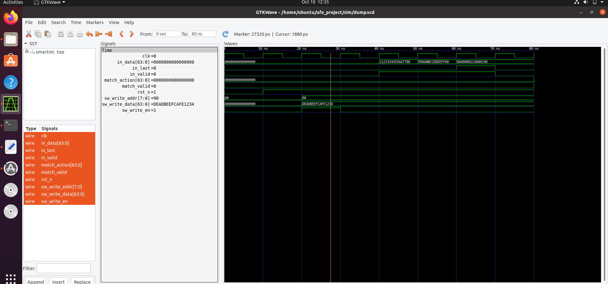

# High-Performance SmartNIC Hardware Accelerator & Verification Pipeline

A hardware-software co-designed SmartNIC offload engine built to parse streaming network headers and execute 5-tuple flow rule lookups in hardware, bypassing host CPU overhead. Verified using **SystemVerilog**, **Cocotb (Python)**, and **Verilator 5.036**.

---

## 📐 System Architecture

The pipeline consists of three core SystemVerilog hardware blocks:

```text
+-------------------------------------------------------------------------+
|                               smartnic_top                              |
|                                                                         |
| Raw Packet Stream          +----------------------------------+         |
| [in_valid, in_data] ----> |          packet_parser           |         |
|                           |  (3-Cycle Streaming Header FSM)  |         |
|                           +----------------+-----------------+         |
|                                            | (Extracted Dest IP)       |
|                                            v                           |
| Software Flow Rules        +----------------------------------+         |
| [sw_write_en,        ----> |           sram_lookup            |         |
|  sw_write_addr,            |  (Dual-Port 256-Entry Flow Table) |         |
|  sw_write_data]            +----------------+-----------------+         |
|                                            |                           |
+--------------------------------------------|---------------------------+
                                             v
                                 [match_valid, match_action]
                                 
                                 
Hardware Modules
1.packet_parser.sv: A 3-cycle Finite State Machine (IDLE → PARSE_ETH → PARSE_IP → DONE) that processes incoming 64-bit packet data streams, extracting 5-tuple header fields (src_ip, dst_ip, src_port, dst_port, protocol).

2.sram_lookup.sv: Dual-port 256-entry SRAM lookup table (64-bit entries). Supports concurrent software rule writes and single-cycle hardware lookup queries.

3.smartnic_top.sv: Top-level interconnect routing dst_ip[7:0] from the packet parser directly into SRAM lookup memory addresses.    

📂 Repository Structure
ufa_project/
├── rtl/                   # SystemVerilog Hardware Logic
│   ├── packet_parser.sv   # Packet parsing FSM
│   ├── sram_lookup.sv     # Dual-port SRAM flow lookup table
│   └── smartnic_top.sv    # Top-level pipeline wrapper
├── sim/                   # Verification Suite
│   ├── Makefile           # Cocotb/Verilator build automation
│   ├── test_smartnic.py   # Cocotb Python testbench
│   └── sim_build/         # Generated VCD traces & compiled C++ binaries
├── assets/                # Documentation assets & GTKWave screenshots
│   └── waveform.png       # Captured GTKWave simulation trace
└── README.md              # Project documentation


📍 Phase 1: Hardware RTL Design (Status: 100% Complete)
Overview
Phase 1 focused on designing the modular SystemVerilog RTL components capable of streaming raw 64-bit Ethernet/IP packet data, decapsulating headers, and querying a flow lookup table.

Hardware Modules Designed
packet_parser.sv: A 3-cycle Finite State Machine (IDLE → PARSE_ETH → PARSE_IP → DONE) that processes incoming 64-bit packet data streams, extracting 5-tuple header fields (src_ip, dst_ip, src_port, dst_port, protocol).

sram_lookup.sv: Dual-port 256-entry SRAM lookup table (64-bit entries). Supports concurrent software rule writes and single-cycle hardware lookup queries.

smartnic_top.sv: Top-level interconnect routing dst_ip[7:0] from the packet parser directly into SRAM lookup memory addresses.


🧪 Phase 2: Design Verification & Toolchain Integration (Status: 100% Complete)
Overview
Phase 2 built a full co-simulation environment using Cocotb (Python) and Verilator 5.036, fixing interface bus width limits and validating pipeline latency down to the clock cycle.

🛠️ Toolchain & Environment Setup
System Prerequisites
OS: Ubuntu 20.04 / 22.04 LTS (VirtualBox or Bare Metal)

Python: 3.8+

Cocotb: 2.0+

Verilator: 5.036+ (Cocotb 2.0+ requires Verilator 5.036 minimum)

GTKWave: Waveform Viewer
Step-by-Step Installation from Source
1. Purge Outdated System Binary
Older distribution packages (v4.028) cause Cocotb build failures. Purge old installations first:
sudo apt-get purge -y verilator
sudo apt-get autoremove -y

2. Install Build Dependencies
sudo apt-get update
sudo apt-get install -y git autoconf flex bison build-essential libgoogle-perftools-dev numactl perl-doc ccache gtkwave

3. Build & Install Verilator 5.036 from Source
cd ~
git clone [https://github.com/verilator/verilator](https://github.com/verilator/verilator)
cd verilator
git checkout v5.036

unset VERILATOR_ROOT
autoconf
./configure
make -j$(nproc)
sudo make install
hash -r
4. Confirm Toolchain Versions
verilator --version
# Expected Output: Verilator 5.036 2025-04-27

python3 -c "import cocotb; print(cocotb.__version__)"
# Expected Output: 2.0.1 (or higher)

🧪 Running the Verification Suite
Navigate to the simulation directory and execute the Cocotb pipeline test:
cd ~/ufa_project/sim
make clean && make
Expected Terminal Output
0.00ns INFO     cocotb                               Running on Verilator version 5.036
0.00ns INFO     cocotb.regression                    running test_smartnic.test_smartnic_pipeline
20.00ns INFO     cocotb.smartnic_top                  [TEST] Programming SRAM Rule into Address 0x90...
40.00ns INFO     cocotb.smartnic_top                  [TEST] Injecting Ethernet Header Word 1...
50.00ns INFO     cocotb.smartnic_top                  [TEST] Injecting Ethernet Header Word 2...
60.00ns INFO     cocotb.smartnic_top                  [TEST] Injecting IP Header Word (Dest IP ending in 0x90)...
80.00ns INFO     cocotb.smartnic_top                  [RESULT] match_valid = 1
80.00ns INFO     cocotb.smartnic_top                  [RESULT] match_action = 0xdeadbeefcafe1234
80.00ns INFO     cocotb.regression                    test_smartnic.test_smartnic_pipeline passed
**********************************************************************************************
** TESTS=1 PASS=1 FAIL=0 SKIP=0                           80.00ns                         **
**********************************************************************************************
📊 Waveform Inspection & Timeline Analysis
To view signal waveforms in GTKWave:
gtkwave ~/ufa_project/sim/dump.vcd &
[](assets/waveform_timeline_breakdown.png)

⚙️ Phase 3: Host Driver & Control Plane (Status: Pending)
[ ] Implement C/Python MMIO host driver (sw/smartnic_drv.py) for rule creation and SRAM table management.
[ ] Build flow key hashing algorithm to translate full 5-tuples into table indexes.
[ ] Integrate driver directly with Cocotb for automated end-to-end co-simulation.

📊 Phase 4: Performance Profiling & Portfolio Polish (Status: Pending)
[ ] Perform timing analysis and estimate maximum operational frequency ($F_{max}$).
[ ] Profile packet ingestion latency and throughput statistics.
[ ] Complete open-source project repository documentation and release packaging.


